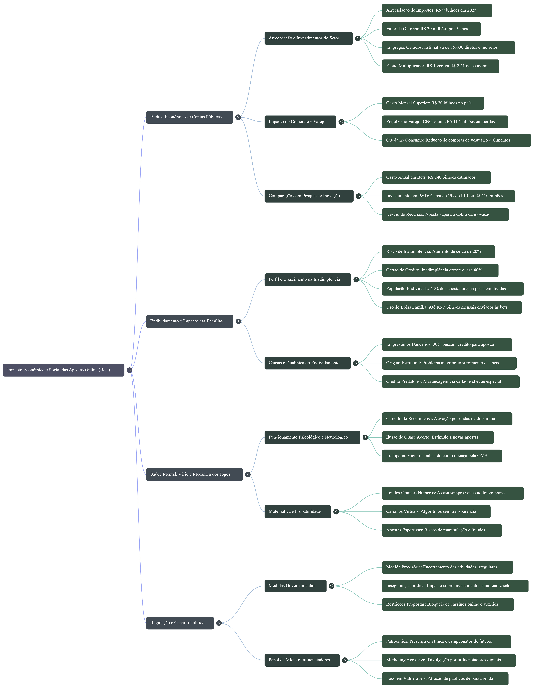
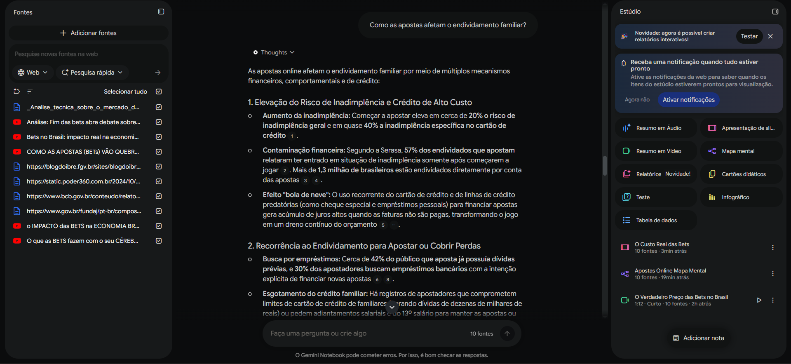

# notebook-repository

Projeto de análise de dados e artigo crítico sobre o impacto socioeconômico e endividamento das famílias brasileiras por bets.

## Mapa mental

## Slides
[Abrir os slides](slides.pdf)

## Evidência de respostas com fonte

**Pergunta:** Como as apostas afetam o endividamento familiar?

**Resposta**: O notebook explicou que começar a apostar aumenta em cerca de 20% o risco de inadimplência (quase 40% no cartão de crédito) e que muitos apostadores recorrem a empréstimos e ao cartão de crédito para financiar novas apostas ou cobrir perdas, o que gera efeito "bola de neve" nas dívidas.

**Fonte**: Análise: Fim das bets abre debate (CNN Brasil)

